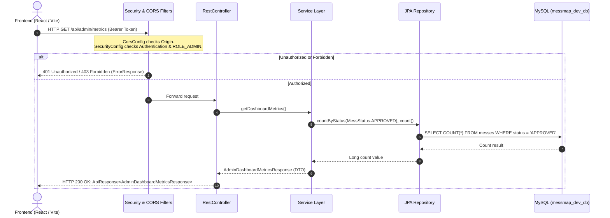

# MessMap — Shared Backend Foundation & Team Handover Guide

> **Target Audience:** All MessMap Developers (@SanvedSahu, @SarthakM28, @Anushka0431)  
> **Repository:** [https://github.com/SanvedSahu/MessMap](https://github.com/SanvedSahu/MessMap)  
> **Current Integration Branch:** `integration/ui-demo`  
> **Backend Baseline:** Java 17 LTS, Spring Boot 3.3.4, MySQL 8.x, Flyway, Spring Data JPA, Spring Security  
> **Last Updated:** October 17, 2026

---

## Table of Contents
1. [Section 1 — Foundation Concepts in Plain Language](#section-1--foundation-concepts-in-plain-language)
2. [Section 2 — Actual Backend Architecture & Request Flow](#section-2--actual-backend-architecture--request-flow)
3. [Section 3 — Shared Database & Entity Contracts](#section-3--shared-database--entity-contracts)
4. [Section 4 — Shared API, Authentication & Authorization Contracts](#section-4--shared-api-authentication--authorization-contracts)
5. [Section 5 — Current Branch, Issue & Integration Status](#section-5--current-branch-issue--integration-status)
6. [Section 6 — Individual Action Checklists for Each Teammate](#section-6--individual-action-checklists-for-each-teammate)
7. [Section 7 — Exact Safe Git Workflow & Branching Strategy](#section-7--exact-safe-git-workflow--branching-strategy)
8. [Section 8 — Daily Commands & Safe Verification Guide](#section-8--daily-commands--safe-verification-guide)
9. [Section 9 — Pre-Implementation Contract Checklist](#section-9--pre-implementation-contract-checklist)

---

## Section 1 — Foundation Concepts in Plain Language

To build MessMap effectively as a team, every member must understand what each tool in our backend stack does and why we chose it.

```
+---------------------------------------------------------------------------------------+
|                                    MESSMAP TECH STACK                                 |
+---------------------------------------------------------------------------------------+
|  React 18 Frontend (Vite)          --> HTTP/JSON Requests                             |
|  Java 17 LTS + Spring Boot 3.3.4   --> Application Framework & Embedded Tomcat        |
|  Spring Web & Controllers          --> REST Endpoints & Request Routing               |
|  Spring Security & BCrypt          --> Role-based Access Control & Password Hashing   |
|  Spring Data JPA & Hibernate       --> Object-Relational Mapping (Java <-> MySQL)     |
|  Flyway Database Migrations        --> Version-controlled SQL Schema Evolution        |
|  MySQL 8.x Database (`messmap_dev_db`) --> Persistent Relational Data Store          |
+---------------------------------------------------------------------------------------+
```

### 1. Spring Boot 3
- **What it does:** Spring Boot is our core application framework. It takes care of low-level plumbing (like setting up an HTTP server, reading configuration files, managing database connection pools) so we can focus on writing business logic.
- **In our project:** When you run `./mvnw spring-boot:run`, Spring Boot spins up an embedded Apache Tomcat web server on port `8080`, scans our classes for annotations (like `@RestController`, `@Service`, `@Repository`), and configures the connection to MySQL.
- **Source Evidence:** [backend/src/main/java/com/messmap/MessMapApplication.java](file:///Users/sanvedsahu/Projects/MessMap/backend/src/main/java/com/messmap/MessMapApplication.java#L11-L18).

### 2. Java 17 LTS
- **What it does:** Java 17 is the Long-Term Support (LTS) release required by Spring Boot 3. It provides modern Java features like records, pattern matching, switch expressions, and text blocks.
- **In our project:** Both our Maven configuration and GitHub Actions CI strictly enforce Java 17. Even if you use Java 21 for university coursework in another terminal, our project builds exclusively against Java 17.
- **Source Evidence:** [backend/pom.xml](file:///Users/sanvedsahu/Projects/MessMap/backend/pom.xml#L18-L20) and [.github/workflows/backend-ci.yml](file:///Users/sanvedsahu/Projects/MessMap/.github/workflows/backend-ci.yml#L44-L48).

### 3. Maven Wrapper (`./mvnw`)
- **What it does:** The Maven Wrapper ensures that every developer and our CI server use the exact same Maven version (`3.9.6`) without requiring you to install Maven globally on your operating system.
- **In our project:** You execute `./mvnw clean test` or `./mvnw spring-boot:run` from the `backend/` directory.
- **Source Evidence:** [backend/mvnw](file:///Users/sanvedsahu/Projects/MessMap/backend/mvnw) and [backend/.mvn/wrapper/maven-wrapper.properties](file:///Users/sanvedsahu/Projects/MessMap/backend/.mvn/wrapper/maven-wrapper.properties#L1-L3).

### 4. MySQL 8.x & `messmap_dev_db`
- **What it does:** MySQL is our relational database management system (RDBMS) that stores users, messes, menus, reviews, favorites, and complaints across server restarts.
- **In our project:** Our team has agreed on a single unified local development database name: **`messmap_dev_db`**. Never configure or run against the legacy database name `messmap_db`.
- **Source Evidence:** [.env.example](file:///Users/sanvedsahu/Projects/MessMap/.env.example#L9) and [backend/src/main/resources/application.yml](file:///Users/sanvedsahu/Projects/MessMap/backend/src/main/resources/application.yml#L13).

### 5. Flyway Database Migrations
- **What it does:** Flyway tracks and applies database changes sequentially using versioned SQL scripts. When someone adds a column or table, they write a script like `V2__create_complaints_schema.sql`. When another developer pulls the code and starts the app, Flyway executes the script automatically.
- **The Golden Rule of Flyway:** **Never edit a migration script that has already been executed or committed.** Changing even a single space in `V1__initial_schema.sql` changes its checksum and breaks everyone's local database (`FlywayValidateException`). Always add a new script (e.g. `V3__...sql`).
- **Source Evidence:** [backend/src/main/resources/db/migration/V1__initial_schema.sql](file:///Users/sanvedsahu/Projects/MessMap/backend/src/main/resources/db/migration/V1__initial_schema.sql) and [backend/src/main/resources/db/migration/V2__create_complaints_schema.sql](file:///Users/sanvedsahu/Projects/MessMap/backend/src/main/resources/db/migration/V2__create_complaints_schema.sql).

### 6. Spring Data JPA & Hibernate
- **What it does:** Instead of writing raw SQL strings (`SELECT * FROM users WHERE email = ?`) in Java, Hibernate maps Java classes ("Entities") directly to MySQL tables. Spring Data JPA automatically generates SQL queries when you declare repository methods like `findByEmail(String email)`.
- **In our project:** We configure `spring.jpa.hibernate.ddl-auto: validate`. This means Hibernate strictly validates that our Java entity classes match our MySQL tables on startup. If a field type or column is missing, Spring Boot fails to start immediately, preventing silent data bugs.
- **Source Evidence:** [backend/src/main/resources/application.yml](file:///Users/sanvedsahu/Projects/MessMap/backend/src/main/resources/application.yml#L19-L26) and [backend/src/main/java/com/messmap/modules/user/repository/UserRepository.java](file:///Users/sanvedsahu/Projects/MessMap/backend/src/main/java/com/messmap/modules/user/repository/UserRepository.java#L16-L30).

### 7. Spring Security & BCrypt
- **What it does:** Spring Security intercepts incoming HTTP requests to check if the caller is logged in and whether they possess the required permissions. BCrypt is a secure, slow hashing algorithm that protects user passwords so plaintext passwords are never saved.
- **In our project:** Passwords are hashed before database insertion. Endpoints under `/api/admin/**` require `ROLE_ADMIN`, while endpoints like `/api/v1/health` and `/api/v1/messes/public/**` are public.
- **Source Evidence:** [backend/src/main/java/com/messmap/config/SecurityConfig.java](file:///Users/sanvedsahu/Projects/MessMap/backend/src/main/java/com/messmap/config/SecurityConfig.java#L34-L54).

### 8. JWT (JSON Web Tokens)
- **What it does:** JWT enables stateless authentication. When a user logs in, the backend signs a cryptographic token containing their user ID and role. The frontend stores this token and sends it in the `Authorization: Bearer <token>` header on subsequent requests. The backend verifies the signature without needing server-side sessions.
- **In our project:** Token secrets and expiration durations are configured in `application.yml`.
- **Source Evidence:** [backend/src/main/resources/application.yml](file:///Users/sanvedsahu/Projects/MessMap/backend/src/main/resources/application.yml#L37-L39).

### 9. Core Backend Architecture Terminology
- **Entity:** A Java class that mirrors a database table. Each instance corresponds to a row (e.g. [User.java](file:///Users/sanvedsahu/Projects/MessMap/backend/src/main/java/com/messmap/modules/user/entity/User.java)).
- **Repository:** An interface extending `JpaRepository` that performs database CRUD operations without boilerplate SQL (e.g. [MessRepository.java](file:///Users/sanvedsahu/Projects/MessMap/backend/src/main/java/com/messmap/modules/mess/repository/MessRepository.java)).
- **Service:** A Java class marked with `@Service` containing business logic, validations, calculations, and transaction boundaries (e.g. [AdminMetricsService.java](file:///Users/sanvedsahu/Projects/MessMap/backend/src/main/java/com/messmap/modules/admin/service/AdminMetricsService.java)).
- **Controller:** A Java class marked with `@RestController` that receives HTTP requests (GET, POST, PUT, DELETE), validates request payloads, invokes services, and returns HTTP responses (e.g. [HealthController.java](file:///Users/sanvedsahu/Projects/MessMap/backend/src/main/java/com/messmap/modules/health/controller/HealthController.java)).
- **DTO (Data Transfer Object):** A plain object defining the exact JSON shape received from or sent to the client, preventing internal database entities from being exposed directly over the network (e.g. [AdminDashboardMetricsResponse.java](file:///Users/sanvedsahu/Projects/MessMap/backend/src/main/java/com/messmap/modules/admin/dto/AdminDashboardMetricsResponse.java)).
- **ApiResponse Envelope:** The standard JSON wrapper returned by all successful MessMap endpoints (`{ success, message, data, timestamp }`).
- **GlobalExceptionHandler:** Centralized error catcher that translates exceptions into clean, consistent JSON error responses (`ErrorResponse`).
- **Source Evidence:** [backend/src/main/java/com/messmap/common/dto/ApiResponse.java](file:///Users/sanvedsahu/Projects/MessMap/backend/src/main/java/com/messmap/common/dto/ApiResponse.java) and [backend/src/main/java/com/messmap/common/exception/GlobalExceptionHandler.java](file:///Users/sanvedsahu/Projects/MessMap/backend/src/main/java/com/messmap/common/exception/GlobalExceptionHandler.java).

### 10. CORS (Cross-Origin Resource Sharing)
- **What it does:** Web browsers block frontend JavaScript running on one port (e.g. `http://localhost:5173`) from calling a backend running on a different port (e.g. `http://localhost:8080`) unless the backend explicitly declares that origin as allowed.
- **In our project:** We configure CORS to permit Vite frontend development (`http://localhost:5173`, `http://127.0.0.1:5173`) as well as standard React development ports (`http://localhost:3000`, `http://localhost:3001`).
- **Source Evidence:** [backend/src/main/java/com/messmap/config/CorsConfig.java](file:///Users/sanvedsahu/Projects/MessMap/backend/src/main/java/com/messmap/config/CorsConfig.java#L22).

---

## Section 2 — Actual Backend Architecture & Request Flow

### Request Flow Lifecycle



### Actual Package Structure & Responsibilities

The backend follows a domain-driven, modular package layout under `com.messmap`:

```text
backend/src/main/java/com/messmap/
├── MessMapApplication.java               # Main Spring Boot entry point & @EnableJpaAuditing
│
├── common/                               # Cross-cutting shared utilities
│   ├── dto/
│   │   ├── ApiResponse.java             # Standard success JSON envelope: { success, message, data, timestamp }
│   │   └── ErrorResponse.java           # Standard error JSON envelope: { success: false, status, error, message, details }
│   ├── entity/
│   │   └── BaseEntity.java              # Abstract class providing auto-audited createdAt and updatedAt
│   └── exception/
│       ├── BadRequestException.java     # Mapped to HTTP 400
│       ├── ResourceNotFoundException.java# Mapped to HTTP 404
│       ├── DuplicateResourceException.java# Mapped to HTTP 409
│       ├── UnauthorizedException.java   # Mapped to HTTP 401
│       └── GlobalExceptionHandler.java  # @RestControllerAdvice handling validation and runtime errors
│
├── config/                               # Core infrastructure configurations
│   ├── CorsConfig.java                  # Allowed origins (5173, 3000, 3001), methods, headers
│   └── SecurityConfig.java              # BCryptPasswordEncoder & HTTP route access rules
│
└── modules/                              # Business domain modules
    ├── admin/                            # Admin overview metrics (Issue #2)
    │   ├── controller/AdminMetricsController.java
    │   ├── dto/AdminDashboardMetricsResponse.java
    │   └── service/AdminMetricsService.java
    ├── complaint/                        # Student grievances & audit logs (Issue #1 Foundation)
    │   ├── entity/Complaint.java
    │   ├── entity/ComplaintCategory.java
    │   ├── entity/ComplaintSeverity.java
    │   ├── entity/ComplaintStatus.java
    │   └── repository/ComplaintRepository.java
    ├── favorite/                         # Student saved messes
    │   ├── entity/Favorite.java
    │   └── repository/FavoriteRepository.java
    ├── health/                           # Health check diagnostics
    │   ├── controller/HealthController.java
    │   └── dto/HealthResponse.java
    ├── menu/                             # Mess dishes and pricing
    │   ├── entity/MenuItem.java
    │   ├── entity/MealType.java
    │   └── repository/MenuItemRepository.java
    ├── mess/                             # Mess listings, facilities, showcase images
    │   ├── entity/Mess.java
    │   ├── entity/MessImage.java
    │   ├── entity/Facility.java
    │   ├── entity/MessStatus.java
    │   ├── entity/OperatingStatus.java
    │   ├── entity/FoodType.java
    │   ├── repository/MessRepository.java
    │   ├── repository/MessImageRepository.java
    │   └── repository/FacilityRepository.java
    ├── review/                           # Student ratings & reviews
    │   ├── entity/Review.java
    │   ├── entity/ReviewStatus.java
    │   └── repository/ReviewRepository.java
    └── user/                             # Users, roles, credentials
        ├── entity/User.java
        ├── entity/Role.java
        ├── entity/UserStatus.java
        └── repository/UserRepository.java
```

---

## Section 3 — Shared Database & Entity Contracts

The database tables below are shared across all three modules. **No developer may alter these tables, column names, or enum names without whole-team consensus.**

### 1. `users` Table
- **Java Entity:** [User.java](file:///Users/sanvedsahu/Projects/MessMap/backend/src/main/java/com/messmap/modules/user/entity/User.java)
- **Table Name:** `users`
- **Important Columns:**
  - `id` (BIGINT, PK, Auto-increment)
  - `name` (VARCHAR(100), NOT NULL)
  - `email` (VARCHAR(150), NOT NULL, UNIQUE)
  - `password` (VARCHAR(255), NOT NULL, BCrypt hashed, `@JsonIgnore`)
  - `phone` (VARCHAR(20))
  - `role` (VARCHAR(30), NOT NULL)
  - `status` (VARCHAR(30), NOT NULL, DEFAULT `'ACTIVE'`)
  - `college` (VARCHAR(150)), `hostel` (VARCHAR(100)), `avatar_url` (VARCHAR(255))
  - `created_at`, `updated_at` (TIMESTAMP, NOT NULL)
- **Enums:**
  - `Role`: `ROLE_STUDENT`, `ROLE_MESS_OWNER`, `ROLE_ADMIN` ([Role.java](file:///Users/sanvedsahu/Projects/MessMap/backend/src/main/java/com/messmap/modules/user/entity/Role.java))
  - `UserStatus`: `ACTIVE`, `SUSPENDED`, `PENDING_VERIFICATION` ([UserStatus.java](file:///Users/sanvedsahu/Projects/MessMap/backend/src/main/java/com/messmap/modules/user/entity/UserStatus.java))
- **Dependent Modules:** All modules (Admin, Student, Mess Owner).

### 2. `messes` Table
- **Java Entity:** [Mess.java](file:///Users/sanvedsahu/Projects/MessMap/backend/src/main/java/com/messmap/modules/mess/entity/Mess.java)
- **Table Name:** `messes`
- **Important Columns:**
  - `id` (BIGINT, PK, Auto-increment)
  - `owner_id` (BIGINT, FK to `users(id)`, NOT NULL)
  - `name` (VARCHAR(150), NOT NULL), `description` (TEXT)
  - `address` (VARCHAR(255), NOT NULL), `city` (VARCHAR(100), NOT NULL), `area` (VARCHAR(100)), `pincode` (VARCHAR(20))
  - `latitude`, `longitude` (DECIMAL(10, 7))
  - `food_type` (VARCHAR(50), NOT NULL, DEFAULT `'VEG_AND_NON_VEG'`)
  - `daily_price` (DECIMAL(8, 2)), `monthly_price` (DECIMAL(8, 2))
  - `status` (VARCHAR(30), NOT NULL, DEFAULT `'PENDING'`)
  - `operating_status` (VARCHAR(30), NOT NULL, DEFAULT `'OPEN'`)
  - `rejection_reason` (VARCHAR(255)), `hero_image` (VARCHAR(500)), `capacity` (INT)
- **Enums:**
  - `MessStatus`: `PENDING`, `APPROVED`, `REJECTED`, `SUSPENDED` ([MessStatus.java](file:///Users/sanvedsahu/Projects/MessMap/backend/src/main/java/com/messmap/modules/mess/entity/MessStatus.java))
  - `OperatingStatus`: `OPEN`, `CLOSED`, `TEMPORARY_CLOSURE` ([OperatingStatus.java](file:///Users/sanvedsahu/Projects/MessMap/backend/src/main/java/com/messmap/modules/mess/entity/OperatingStatus.java))
  - `FoodType`: `PURE_VEG`, `VEG_AND_NON_VEG`, `JAIN_FRIENDLY` ([FoodType.java](file:///Users/sanvedsahu/Projects/MessMap/backend/src/main/java/com/messmap/modules/mess/entity/FoodType.java))
- **Relationships:** `@ManyToOne` to `User` (owner), `@OneToMany` to `MenuItem`, `@OneToMany` to `MessImage`, `@ManyToMany` to `Facility`.
- **Dependent Modules:** Mess Owner (management), Student (discovery), Admin (verification & metrics).

### 3. `menu_items` Table
- **Java Entity:** [MenuItem.java](file:///Users/sanvedsahu/Projects/MessMap/backend/src/main/java/com/messmap/modules/menu/entity/MenuItem.java)
- **Table Name:** `menu_items`
- **Important Columns:**
  - `id` (BIGINT, PK, Auto-increment)
  - `mess_id` (BIGINT, FK to `messes(id)`, NOT NULL, `ON DELETE CASCADE`)
  - `name` (VARCHAR(150), NOT NULL), `description` (VARCHAR(255)), `price` (DECIMAL(8, 2))
  - `meal_type` (VARCHAR(30), NOT NULL), `is_available` (BOOLEAN, DEFAULT TRUE), `day_of_week` (VARCHAR(20))
- **Enums:**
  - `MealType`: `BREAKFAST`, `LUNCH`, `DINNER`, `SNACKS` ([MealType.java](file:///Users/sanvedsahu/Projects/MessMap/backend/src/main/java/com/messmap/modules/menu/entity/MealType.java))
- **Dependent Modules:** Mess Owner (Menu management), Student (Menu viewing).

### 4. `reviews` Table
- **Java Entity:** [Review.java](file:///Users/sanvedsahu/Projects/MessMap/backend/src/main/java/com/messmap/modules/review/entity/Review.java)
- **Table Name:** `reviews`
- **Important Columns:**
  - `id` (BIGINT, PK), `user_id` (BIGINT, FK to `users`), `mess_id` (BIGINT, FK to `messes`)
  - `rating` (INT, 1 to 5), `food_quality_score` (INT, 1 to 5), `hygiene_score` (INT, 1 to 5)
  - `comment` (TEXT), `status` (VARCHAR(30), DEFAULT `'PUBLISHED'`)
- **Enums:**
  - `ReviewStatus`: `PUBLISHED`, `FLAGGED`, `REMOVED` ([ReviewStatus.java](file:///Users/sanvedsahu/Projects/MessMap/backend/src/main/java/com/messmap/modules/review/entity/ReviewStatus.java))
- **Dependent Modules:** Student (Submission), Mess Owner (Viewing), Admin (Moderation).

### 5. `favorites` Table
- **Java Entity:** [Favorite.java](file:///Users/sanvedsahu/Projects/MessMap/backend/src/main/java/com/messmap/modules/favorite/entity/Favorite.java)
- **Table Name:** `favorites`
- **Important Columns:**
  - `id` (BIGINT, PK), `user_id` (BIGINT, FK), `mess_id` (BIGINT, FK)
  - Unique Constraint: `uk_favorites_user_mess UNIQUE (user_id, mess_id)`
- **Dependent Modules:** Student (Favorites management).

### 6. `complaints` Table
- **Java Entity:** [Complaint.java](file:///Users/sanvedsahu/Projects/MessMap/backend/src/main/java/com/messmap/modules/complaint/entity/Complaint.java)
- **Table Name:** `complaints` (Created in `V2__create_complaints_schema.sql`)
- **Important Columns:**
  - `id` (BIGINT, PK), `ticket_number` (VARCHAR(50), UNIQUE, NOT NULL)
  - `mess_id` (BIGINT, FK to `messes(id)`, NOT NULL, NO CASCADE)
  - `user_id` (BIGINT, FK to `users(id)`, NOT NULL, NO CASCADE)
  - `subject` (VARCHAR(255), NOT NULL), `category` (VARCHAR(50), NOT NULL)
  - `description` (TEXT, NOT NULL), `severity` (VARCHAR(30), DEFAULT `'MEDIUM'`)
  - `status` (VARCHAR(30), DEFAULT `'OPEN'`), `admin_notes` (TEXT), `resolved_at` (TIMESTAMP)
- **Enums:**
  - `ComplaintStatus`: `OPEN`, `UNDER_INVESTIGATION`, `RESOLVED`, `DISMISSED`
  - `ComplaintSeverity`: `LOW`, `MEDIUM`, `HIGH`, `CRITICAL`
  - `ComplaintCategory`: `FOOD_QUALITY`, `HYGIENE_AND_CLEANLINESS`, `OVERCHARGING_AND_DEPOSIT`, `UNAVAILABILITY_EARLY_CLOSURE`, `MISLEADING_MENU`, `STAFF_BEHAVIOR`
- **Crucial Rule:** Complaints preserve audit history. They **do not** use cascading deletes.
- **Dependent Modules:** Student (Submitting grievances), Admin (Resolution & Moderation).

### 7. Facilities & Mess Images
- `facilities`: Amenities (`WiFi`, `RO Purified Water`, `Hot Water`, `AC Dining`, `Parking Space`, `CCTV Security`).
- `mess_facilities`: Join table linking `mess_id` and `facility_id`.
- `mess_images`: Gallery photos with `image_url` and `is_primary` flag.

---

## Section 4 — Shared API, Authentication & Authorization Contracts

### Implemented vs. Planned Status

| Endpoint | Method | Role Restriction | Status | Source File |
| :--- | :--- | :--- | :---: | :--- |
| `/api/v1/health` | GET | Public (Permit All) | **IMPLEMENTED** | [HealthController.java](file:///Users/sanvedsahu/Projects/MessMap/backend/src/main/java/com/messmap/modules/health/controller/HealthController.java) |
| `/api/admin/metrics` | GET | `ROLE_ADMIN` | **IMPLEMENTED** (on `feature/foundation-and-admin`) | [AdminMetricsController.java](file:///Users/sanvedsahu/Projects/MessMap/backend/src/main/java/com/messmap/modules/admin/controller/AdminMetricsController.java) |
| `/api/admin/dashboard/summary` | GET | `ROLE_ADMIN` | **IMPLEMENTED** (Alias) | [AdminMetricsController.java](file:///Users/sanvedsahu/Projects/MessMap/backend/src/main/java/com/messmap/modules/admin/controller/AdminMetricsController.java) |
| `/api/v1/admin/metrics` | GET | `ROLE_ADMIN` | **IMPLEMENTED** (v1 Prefix) | [AdminMetricsController.java](file:///Users/sanvedsahu/Projects/MessMap/backend/src/main/java/com/messmap/modules/admin/controller/AdminMetricsController.java) |
| `/api/v1/auth/register/owner` | POST | Public | **IMPLEMENTED** (on `feature/owner-api-and-ui`) | `AuthController.java` (Sarthak) |
| `/api/v1/auth/login` | POST | Public | **IMPLEMENTED** (on `feature/owner-api-and-ui`) | `AuthController.java` (Sarthak) |
| `/api/v1/owner/profile` | GET / PUT | `ROLE_MESS_OWNER`, `ROLE_ADMIN` | **IMPLEMENTED** (on `feature/owner-api-and-ui`) | `OwnerProfileController.java` (Sarthak) |
| `/api/v1/auth/student/register` | POST | Public | **NOT YET IMPLEMENTED** (Issue #7 - Anushka) | — |
| `/api/v1/student/profile` | GET / PUT | `ROLE_STUDENT` | **NOT YET IMPLEMENTED** (Issue #7 - Anushka) | — |
| `/api/v1/messes/nearby` | GET | Public / Student | **NOT YET IMPLEMENTED** (Issue #8) | — |
| `/api/v1/favorites` | GET / POST | `ROLE_STUDENT` | **NOT YET IMPLEMENTED** (Issue #9) | — |
| `/api/v1/reviews` | POST | `ROLE_STUDENT` | **NOT YET IMPLEMENTED** (Issue #10) | — |
| `/api/admin/users` | GET / PATCH | `ROLE_ADMIN` | **NOT YET IMPLEMENTED** (Issue #3) | — |
| `/api/admin/messes` | GET / PATCH | `ROLE_ADMIN` | **NOT YET IMPLEMENTED** (Issue #4) | — |

### How Role-Based Access Control Works
1. In `Role.java`, roles are named `ROLE_STUDENT`, `ROLE_MESS_OWNER`, `ROLE_ADMIN`.
2. In Spring Security:
   - When using `.hasRole("ADMIN")` in `SecurityConfig` or `@PreAuthorize("hasRole('ADMIN')")`, Spring Security **automatically prepends** `ROLE_` and looks for authority `ROLE_ADMIN`.
   - When using `.hasAuthority("ROLE_ADMIN")` or `@PreAuthorize("hasAuthority('ROLE_ADMIN')")`, Spring Security checks the exact string `ROLE_ADMIN`.
   - **Team Rule:** Always pass `"ADMIN"`, `"MESS_OWNER"`, or `"STUDENT"` to `hasRole(...)` (omit the `ROLE_` prefix inside `hasRole`).

### Standard Response Envelope (`ApiResponse<T>`)
Every successful API endpoint MUST return data wrapped in `ApiResponse<T>`:
```json
{
  "success": true,
  "message": "Admin dashboard metrics retrieved successfully",
  "data": {
    "totalUsers": 3,
    "activeMesses": 1,
    "pendingVerification": 1,
    "suspendedMesses": 1,
    "totalMesses": 3
  },
  "timestamp": "2026-10-17T19:17:30.123456"
}
```

### Standard Error Envelope (`ErrorResponse`)
Whenever an exception is thrown, `GlobalExceptionHandler` intercepts it and returns:
```json
{
  "success": false,
  "status": 404,
  "error": "Not Found",
  "message": "Mess not found with id: '42'",
  "timestamp": "2026-10-17T19:17:30.654321",
  "path": "/api/v1/messes/42",
  "details": []
}
```
Validation failures (`MethodArgumentNotValidException`) populate the `details` array with field-level error messages (e.g. `["email: Invalid email format", "password: Password is required"]`).

---

## Section 5 — Current Branch, Issue & Integration Status

```
                                      INTEGRATION & BRANCH TOPOLOGY
                                      
               (Early Prototyping)
               c3887ce [origin/feature/mess-owner] (Owner UI prototype - based on early 1a6e913)
               d0211a0 [origin/feature/user]       (Student UI prototype - based on early 1a6e913)
                     \
                      \ 
                       5978bc0 [origin/integration/ui-demo] <--- TEAM MERGE TARGET (Contains Issue #1 Foundation)
                       /    \
                      /      \
                     /        v
                    /       a425755 [origin/feature/owner-api-and-ui] (Sarthak - Issue #12 Owner Auth & JWT)
                   v
             f3cde5d (Sanved - Issue #2 Admin Metrics & V2 Complaints)
                   |
             24599cf [feature/foundation-and-admin] (Sanved - CORS fix for port 3001)
```

### Status Matrix

| Branch Name | Author | Base Commit | Latest Commit | What is Included | Integration Status |
| :--- | :--- | :--- | :--- | :--- | :--- |
| `integration/ui-demo` | Shared | — | `5978bc0` | PR #21: Initial Spring Boot foundation (Flyway V1, core entities, BaseEntity, HealthController, ApiResponse, GlobalExceptionHandler). | **Merged Base** |
| `feature/foundation-and-admin` | Sanved | `5978bc0` | `24599cf` | Issue #2: Admin metrics service/controller/tests, Flyway V2 (`complaints` table & entity), `messmap_dev_db` default, CORS fix (`3001`). | **Ready for PR to `integration/ui-demo`** |
| `feature/owner-api-and-ui` | Sarthak | `5978bc0` | `a425755` | Issue #12: JJWT dependencies in `pom.xml`, `com.messmap.security` (`JwtTokenProvider`, `JwtAuthenticationFilter`, `UserPrincipal`), Owner register/login/profile APIs & tests. | **Ready for PR to `integration/ui-demo`** |
| `feature/student-api-and-ui` | Anushka | `1a6e913` | `d0211a0` | Frontend student UI only. Backend Issue #7 has **not** started yet. | **Pending Backend Start** |

### Verified Observations & Warnings
1. **Issue #1 in `integration/ui-demo`:** Merged via PR #21 at commit `5978bc0`.
2. **Issue #2 & V2 in `feature/foundation-and-admin`:** Fully tested and building cleanly (24/24 tests passing). Not yet merged into `integration/ui-demo`.
3. **Issue #12 in `feature/owner-api-and-ui`:** Sarthak has implemented the complete JWT authentication and token provider layer. This is vital because **Anushka should reuse Sarthak's `JwtTokenProvider` and `UserPrincipal`** rather than creating a duplicate JWT security system for Students!
4. **Integration Ordering:** Sanved and Sarthak should merge their pull requests into `integration/ui-demo` first. Then Anushka should pull the updated `integration/ui-demo` before starting Issue #7.

---

## Section 6 — Individual Action Checklists for Each Teammate

### 1. Sanved Sahu — Admin & Integration Checklist
- [x] Shared backend foundation established (Issue #1).
- [x] Flyway `V2__create_complaints_schema.sql` and `Complaint` JPA entity implemented.
- [x] Admin Dashboard Metrics API (`/api/admin/metrics`, `/api/admin/dashboard/summary`) implemented and tested (Issue #2).
- [x] Database standardized to `messmap_dev_db` across `.env.example`, `application.yml`, and `docker-compose-db.yml`.
- [x] CORS updated to allow `http://localhost:3001` alongside `3000` and `5173`.
- [ ] **Next Step 1:** Open a Pull Request from `feature/foundation-and-admin` to `integration/ui-demo`.
- [ ] **Next Step 2:** Review and merge Sarthak's PR for Issue #12 into `integration/ui-demo`. Ensure `SecurityConfig` merges cleanly:
  - Sanved's rule: `.requestMatchers("/api/admin/**", "/api/v1/admin/**").hasRole("ADMIN")`
  - Sarthak's rule: `.requestMatchers("/api/v1/owner/**").hasAnyAuthority("ROLE_MESS_OWNER", "ROLE_ADMIN")`
- [ ] **Next Step 3:** Proceed with Issue #3 (Admin User Management) and Issue #4 (Admin Mess Verification) on a fresh branch cut from updated `integration/ui-demo`.

### 2. Sarthak M28 — Mess Owner Checklist
- [x] Owner registration, authentication, and profile APIs implemented on `feature/owner-api-and-ui` (Issue #12).
- [x] Core JWT classes created: `JwtTokenProvider`, `JwtAuthenticationFilter`, `UserPrincipal`, `CustomUserDetailsService`.
- [ ] **Next Step 1:** Open a Pull Request from `feature/owner-api-and-ui` into `integration/ui-demo`.
- [ ] **Next Step 2:** Update local database configuration to use `messmap_dev_db` (drop any legacy `messmap_db` reference).
- [ ] **Next Step 3:** Once PR #12 and Sanved's PR are merged into `integration/ui-demo`, pull the latest `integration/ui-demo` into a new feature branch for:
  - **Issue #13:** Owner Mess Profile (`POST /api/owner/messes`, `PUT /api/owner/messes/{id}`)
  - **Issue #14:** Owner Menu Management (`POST /api/owner/messes/{id}/menus`)
  - **Issue #15:** Owner Verification Submission
- [ ] **Do Not Duplicate:** Do not create a separate `User` entity, `Mess` entity, or `SecurityConfig`. Use the shared classes in `com.messmap.modules.mess` and `com.messmap.modules.user`.

### 3. Anushka0431 — Student Checklist
- [ ] **Do Not Start Until Integration is Updated:** Wait for Sanved's foundation PR and Sarthak's Issue #12 PR to be merged into `integration/ui-demo`.
- [ ] **Next Step 1:** Pull the latest `integration/ui-demo` and create a dedicated branch: `feature/student-auth-issue-7`.
- [ ] **Next Step 2 — Implement Issue #7 (Student Registration, Authentication & Profile):**
  - **Do NOT write a new JWT provider!** Reuse Sarthak's `com.messmap.security.JwtTokenProvider` and `UserPrincipal`.
  - Add Student endpoints to `AuthController.java`:
    - `POST /api/v1/auth/register/student` (Registers a user with `Role.ROLE_STUDENT`).
    - Reuse existing `POST /api/v1/auth/login` (already handles credentials and issues JWT).
  - Create `StudentProfileController.java`:
    - `GET /api/v1/student/profile` (Strictly `@PreAuthorize("hasRole('STUDENT')")`).
    - `PUT /api/v1/student/profile` (Update college, hostel, phone, name).
- [ ] **Next Step 3 — Subsequent Student Issues:**
  - **Issue #8:** Student Mess Discovery (`GET /api/v1/messes/nearby` using `MessRepository`).
  - **Issue #9:** Student Favorites (`GET /api/v1/favorites`, `POST /api/v1/favorites` using `FavoriteRepository`).
  - **Issue #10:** Student Reviews (`POST /api/v1/reviews` using `ReviewRepository`).

---

## Section 7 — Exact Safe Git Workflow & Branching Strategy

To prevent merge conflicts and accidental overwrites, every developer MUST follow this step-by-step Git protocol.

```
+-----------------------------------------------------------------------------------+
|                            THE GOLDEN RULE OF MESSMAP GIT                         |
|                                                                                   |
|  1. Never commit directly to integration/ui-demo or dev.                          |
|  2. Always branch from origin/integration/ui-demo.                                |
|  3. Run tests BEFORE committing: JAVA_HOME=... ./mvnw clean test package         |
|  4. Never force-push (git push -f) to any shared branch.                          |
|  5. Keep pull requests focused on a single GitHub issue.                          |
+-----------------------------------------------------------------------------------+
```

### 1. Creating a Fresh Feature Branch for a New Issue
Always make sure your local copy of `integration/ui-demo` is 100% up to date before branching:

```bash
# 1. Fetch latest changes from GitHub
git fetch origin

# 2. Switch to the integration branch
git checkout integration/ui-demo

# 3. Pull the latest integrated code
git pull origin integration/ui-demo

# 4. Create your new feature branch (replace <issue-name> with your task, e.g. feature/student-auth)
git checkout -b feature/<issue-name>
```

### 2. Daily Development & Checking What Changed
Before staging files, check what you modified so you do not commit accidental files:

```bash
# Check modified and untracked files
git status --short

# Check exact line changes
git diff

# Ensure no whitespace errors
git diff --check
```

### 3. Running Verification Before Every Commit
Never commit code that fails tests or does not compile:

```bash
# From the backend/ directory
JAVA_HOME=$(/usr/libexec/java_home -v 17) ./mvnw clean test package
```

### 4. Committing and Pushing Safely

```bash
# Stage only the files relevant to your issue
git add backend/src/main/java/com/messmap/modules/...
git add backend/src/test/java/...

# Write a descriptive commit message referencing your issue number
git commit -m "feat(module): implement <feature-description> (#<issue-number>)"

# Push your branch to GitHub
git push -u origin feature/<issue-name>
```

### 5. Updating Your Feature Branch with Team Changes (Non-Destructive)
If another teammate merged code into `integration/ui-demo` while you were working:

```bash
# 1. Fetch remote updates
git fetch origin

# 2. Merge the latest integrated changes into your feature branch
git merge origin/integration/ui-demo

# 3. If there are conflicts, resolve them carefully, run tests, and commit the merge
JAVA_HOME=$(/usr/libexec/java_home -v 17) ./mvnw clean test
git commit -m "chore: merge origin/integration/ui-demo into feature branch"
git push origin feature/<issue-name>
```

---

## Section 8 — Daily Commands & Safe Verification Guide

### 1. Check Java 17 & Maven
On macOS, verify that your active shell uses JDK 17 before executing Maven:

```bash
JAVA_CANDIDATE=$(/usr/libexec/java_home -v 17 2>/dev/null)
if [ -n "$JAVA_CANDIDATE" ] && "$JAVA_CANDIDATE/bin/java" -version 2>&1 | grep -q '"17\.' ; then
    export JAVA_HOME="$JAVA_CANDIDATE"
    export PATH="$JAVA_HOME/bin:$PATH"
    echo "Using JDK 17: $JAVA_HOME"
else
    echo "Error: JDK 17 is not installed."
fi

# Verify Maven Wrapper selects Java 17
cd backend
./mvnw -version
```

### 2. Start MySQL Database
#### Option A: Using Docker Compose
```bash
docker compose -f database/docker-compose-db.yml up -d
```

#### Option B: Using Native Homebrew MySQL on macOS
```bash
brew services start mysql
```

Verify connection non-destructively:
```bash
mysql -u messmap_user -pmessmap_secret_password -h 127.0.0.1 -P 3306 -e "SHOW DATABASES;"
```

### 3. Run Backend Server
```bash
cd backend
JAVA_HOME=$(/usr/libexec/java_home -v 17) ./mvnw clean spring-boot:run
```
The server starts at **`http://localhost:8080`**.

### 4. Test Health Endpoint
In a separate terminal:
```bash
curl -s http://localhost:8080/api/v1/health
```
Expected output:
```json
{"success":true,"message":"MessMap backend service is operational","data":{"status":"UP","service":"MessMap Backend API","version":"1.0.0","environment":"dev"}}
```

### 5. Inspect Flyway Migrations Safely
```bash
mysql -u messmap_user -pmessmap_secret_password -h 127.0.0.1 -P 3306 -e "USE messmap_dev_db; SELECT installed_rank, version, description, type, script, success FROM flyway_schema_history;"
```

### 6. Run Frontend Application
```bash
cd frontend
npm install
npm run dev
```
Frontend runs at **`http://localhost:5173`**.

---

## Section 9 — Pre-Implementation Contract Checklist

Before writing any new code for an assigned issue, every developer must check off these 10 items:

- [ ] **1. Issue Scope:** Read the GitHub issue title, user stories, and acceptance criteria.
- [ ] **2. Clean Base:** Confirm your branch is cut from the latest `origin/integration/ui-demo`.
- [ ] **3. Entity Inspection:** Search `com.messmap.modules` for existing entities before creating a new one (e.g. check `User`, `Mess`, `Review`).
- [ ] **4. Enums & Statuses:** Use existing enums (`Role`, `UserStatus`, `MessStatus`, `FoodType`, etc.). Do not define duplicate status strings.
- [ ] **5. Endpoint URI Conventions:** Follow REST standard naming: `/api/v1/<plural-resource>` (e.g. `/api/v1/messes`, `/api/v1/reviews`).
- [ ] **6. Response Envelope:** Ensure all controller methods wrap successful responses in `ResponseEntity.ok(ApiResponse.success(data))`.
- [ ] **7. Exception Handling:** Throw `ResourceNotFoundException`, `BadRequestException`, or `DuplicateResourceException`. Do not swallow exceptions in empty `catch` blocks.
- [ ] **8. Unit & Repository Tests:** Add test classes under `src/test/java/com/messmap/...` covering your controller, service, or repository.
- [ ] **9. Full Test Suite Execution:** Verify that `./mvnw clean test package` passes without breaking existing teammates' tests.
- [ ] **10. Clean PR Submission:** Review `git diff` before opening a pull request to `integration/ui-demo`. Never include passwords, tokens, or local `.env` files.
