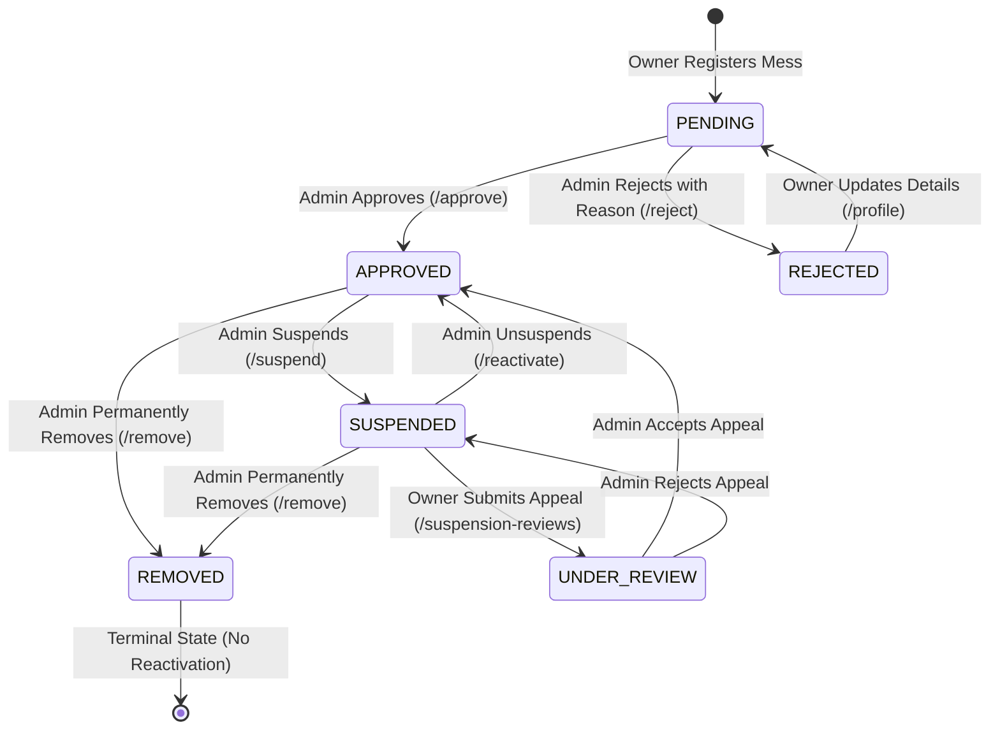

# MessMap — Algorithms, Mathematical Formulas & Logic Reference

> **Audited Branch:** `integration/backend-demo`  
> **Source Verification:** Fully verified against Java Spring Boot backend and TypeScript frontend implementations.  

---

## 1. Haversine Great-Circle Distance Algorithm

### 1.1 Problem Statement
In campus food discovery, calculating the Euclidean straight-line distance on a Cartesian plane (\(\sqrt{\Delta x^2 + \Delta y^2}\)) produces substantial geometric error because the Earth is an oblate spheroid. A degree of longitude at the equator spans approximately 111.32 km, but shrinks as latitude moves toward the poles (\(111.32 \times \cos(\text{lat})\)). 

The **Haversine formula** computes the shortest distance between two points on the surface of a sphere along the great circle, taking latitude and longitude as spherical coordinates.

---

### 1.2 Mathematical Formulation

Given two points:
- **Point 1 (Student / Origin):** \((\phi_1, \lambda_1)\) where \(\phi_1\) is latitude and \(\lambda_1\) is longitude.
- **Point 2 (Mess / Destination):** \((\phi_2, \lambda_2)\) where \(\phi_2\) is latitude and \(\lambda_2\) is longitude.

All angular coordinates must first be converted from degrees to radians:
\[
\text{radians} = \text{degrees} \times \left(\frac{\pi}{180}\right)
\]

Differences in latitude and longitude:
\[
\Delta\phi = \phi_2 - \phi_1 = (\text{lat}_2 - \text{lat}_1) \times \frac{\pi}{180}
\]
\[
\Delta\lambda = \lambda_2 - \lambda_1 = (\text{lon}_2 - \text{lon}_1) \times \frac{\pi}{180}
\]

The square of half the chord length between the points (\(a\)):
\[
a = \sin^2\left(\frac{\Delta\phi}{2}\right) + \cos(\phi_1) \cos(\phi_2) \sin^2\left(\frac{\Delta\lambda}{2}\right)
\]

The angular distance in radians (\(c\)):
\[
c = 2 \cdot \arctan2\left(\sqrt{a}, \sqrt{1 - a}\right)
\]
*(Alternatively expressed as \(c = 2 \arcsin(\sqrt{a})\). The \(\arctan2\) formulation is numerically preferred in computing because it avoids floating-point roundoff errors near antipodal points).*

The great-circle distance (\(d\)):
\[
d = R \cdot c
\]

Where:
- \(R\) = Earth's volumetric mean radius, defined in MessMap source code as **`6371.0` km**.
- \(d\) = Calculated distance in kilometers between student and mess.

---

### 1.3 Actual Source Implementation

#### Backend Implementation (`backend/src/main/java/com/messmap/modules/mess/service/MessDiscoveryService.java`, lines 78-87):

```java
public static double calculateHaversineDistanceKm(double lat1, double lon1, double lat2, double lon2) {
    final double EARTH_RADIUS_KM = 6371.0;
    double dLat = Math.toRadians(lat2 - lat1);
    double dLon = Math.toRadians(lon2 - lon1);
    double a = Math.sin(dLat / 2.0) * Math.sin(dLat / 2.0)
            + Math.cos(Math.toRadians(lat1)) * Math.cos(Math.toRadians(lat2))
            * Math.sin(dLon / 2.0) * Math.sin(dLon / 2.0);
    double c = 2.0 * Math.atan2(Math.sqrt(a), Math.sqrt(1.0 - a));
    return EARTH_RADIUS_KM * c;
}
```

#### Frontend Implementation (`frontend/src/utils/geocoding.ts`, lines 264-286):

```typescript
export function calculateHaversineDistanceKm(
  lat1: number,
  lon1: number,
  lat2: number,
  lon2: number
): number {
  if (!isValidCoordinates(lat1, lon1) || !isValidCoordinates(lat2, lon2)) {
    return NaN;
  }
  const EARTH_RADIUS_KM = 6371.0;
  const dLat = ((lat2 - lat1) * Math.PI) / 180.0;
  const dLon = ((lon2 - lon1) * Math.PI) / 180.0;

  const a =
    Math.sin(dLat / 2) * Math.sin(dLat / 2) +
    Math.cos((lat1 * Math.PI) / 180.0) *
      Math.cos((lat2 * Math.PI) / 180.0) *
      Math.sin(dLon / 2) *
      Math.sin(dLon / 2);

  const c = 2 * Math.atan2(Math.sqrt(a), Math.sqrt(1 - a));
  return Number((EARTH_RADIUS_KM * c).toFixed(2));
}
```

---

### 1.4 Step-by-Step Numerical Example for Viva Defense

**Scenario:** A student standing at the COEP Pune campus wants to find the distance to Fergusson College Road Dining.

- **Point 1 (Student at COEP):** \(\text{lat}_1 = 18.5298^\circ\text{ N}, \text{lon}_1 = 73.8565^\circ\text{ E}\)
- **Point 2 (Mess at FC Road):** \(\text{lat}_2 = 18.5236^\circ\text{ N}, \text{lon}_2 = 73.8418^\circ\text{ E}\)
- **Selected Radius Threshold:** \(R_{\text{search}} = 2.0\text{ km}\)

#### Step 1: Radians Conversion
- \(\phi_1 = 18.5298 \times \frac{\pi}{180} = 0.3234057\text{ rad}\)
- \(\phi_2 = 18.5236 \times \frac{\pi}{180} = 0.3232975\text{ rad}\)
- \(\lambda_1 = 73.8565 \times \frac{\pi}{180} = 1.2890408\text{ rad}\)
- \(\lambda_2 = 73.8418 \times \frac{\pi}{180} = 1.2887842\text{ rad}\)

#### Step 2: Compute Differences
- \(\Delta\phi = 0.3232975 - 0.3234057 = -0.0001082\text{ rad}\)
- \(\Delta\lambda = 1.2887842 - 1.2890408 = -0.0002566\text{ rad}\)

#### Step 3: Compute Chord Factor \(a\)
- \(\sin(\Delta\phi / 2) = \sin(-0.0000541) \approx -0.0000541\)
- \(\sin^2(\Delta\phi / 2) \approx 2.927 \times 10^{-9}\)
- \(\cos(\phi_1) \approx 0.948171\)
- \(\cos(\phi_2) \approx 0.948206\)
- \(\sin(\Delta\lambda / 2) = \sin(-0.0001283) \approx -0.0001283\)
- \(\sin^2(\Delta\lambda / 2) \approx 1.646 \times 10^{-8}\)
- \(a = 2.927 \times 10^{-9} + (0.948171 \times 0.948206 \times 1.646 \times 10^{-8})\)
- \(a = 2.927 \times 10^{-9} + 1.480 \times 10^{-8} = 1.7727 \times 10^{-8}\)

#### Step 4: Compute Angular Distance \(c\)
- \(\sqrt{a} = \sqrt{1.7727 \times 10^{-8}} \approx 0.00013314\)
- \(\sqrt{1 - a} \approx \sqrt{0.99999998} \approx 1.0000\)
- \(c = 2 \times \arctan2(0.00013314, 1.0000) = 2 \times 0.00013314 = 0.00026628\text{ rad}\)

#### Step 5: Compute Distance \(d\)
- \(d = 6371.0 \times 0.00026628 \approx 1.6965\text{ km}\)
- In MessMap, rounded to two decimal places:
  \[
  d = \mathbf{1.70\text{ km}}
  \]

#### Step 6: Radius Filtering Decision
- Condition: Is \(d \le R_{\text{search}}\)?
- \(1.70\text{ km} \le 2.0\text{ km} \implies \mathbf{TRUE}\).
- **Result:** The mess is included in the student's nearby search results and placed at the top of the sorted list.

---

### 1.5 Radius Threshold vs. Visual Map Circle
- **Conceptual Clarification for Viva:** The "radius" in MessMap is an **algorithmic upper-bound threshold filter** (\(d \le \text{radiusKm}\)), not a physical drawn circle boundary. While the frontend map displays a circular overlay for student visual context, filtering is executed by evaluating each mess's calculated scalar distance against this numerical threshold.

---

### 1.6 Server-Side vs. Client-Side Dual Calculation
MessMap implements Haversine distance calculation in both the backend and frontend:
1. **Backend (`MessDiscoveryService.java`):**
   - Filters candidate messes from the database within the requested radius.
   - Sorts the payload ascending by distance before sending it over the network.
   - Sets `distanceKm` in the JSON response DTO.
2. **Frontend (`FindMessPage.tsx` & `geocoding.ts`):**
   - When a student toggles radius (e.g., from 5 km to 2 km) or changes filters locally, the frontend recalculates distances on the client side without issuing redundant HTTP requests.
   - Ensures an instantaneous, 60fps responsive user experience even on slow campus Wi-Fi networks.

---

### 1.7 Handling of Missing or Legacy Coordinates
If a mess in the database has null latitude or longitude (e.g. legacy seed data or administrative test records):
```java
// MessDiscoveryService.java line 124
return messes.stream()
        .filter(m -> m.getLatitude() != null && m.getLongitude() != null)
        .map(...)
```
- Messes with null coordinates are safely excluded from distance-based results without throwing `NullPointerException`.
- When accessing the non-distance listing (`/api/messes`), such messes still appear with locality text.

---

## 2. Location & Geocoding Algorithms

### 2.1 Browser Geolocation Acquisition
- **API Used:** HTML5 standard `navigator.geolocation.getCurrentPosition`.
- **Configuration:**
  ```javascript
  {
    enableHighAccuracy: true, // Forces device GPS / Wi-Fi triangulation over coarse IP lookup
    timeout: 10000,          // 10-second fail-safe timeout
    maximumAge: 0            // Prevents returning stale cached GPS coordinates
  }
  ```
- **Error Handling:**
  - `PERMISSION_DENIED`: Displays error modal guiding user to click the interactive map pin instead.
  - `POSITION_UNAVAILABLE` / `TIMEOUT`: Catches timeout and falls back to manual map placement.

---

### 2.2 Forward Geocoding (Text to Coordinates)
- **External Provider:** OpenStreetMap Nominatim API (`https://nominatim.openstreetmap.org/search`).
- **Algorithm:**
  1. Checks offline campus directory (`KNOWN_CAMPUS_LOCATIONS`) for 31 verified Pune student hubs (COEP, MIT-WPU, Bharati Vidyapeeth, Fergusson College, Viman Nagar, etc.) for instantaneous sub-1ms matching.
  2. If not matched offline, executes an HTTP GET to Nominatim with a 2.5s `AbortController` timeout and custom `User-Agent: MessMap-StudentDiningApp/1.0`.
  3. If Nominatim fails or times out, falls back to Pune Central City centroid (`18.5204° N, 73.8567° E`).

---

### 2.3 Reverse Geocoding (Coordinates to Locality & PIN Code)
- **External Provider:** OpenStreetMap Nominatim Reverse API (`https://nominatim.openstreetmap.org/reverse?format=json&lat={lat}&lon={lon}&zoom=18&addressdetails=1`).
- **Algorithm & Parsing Logic:**
  1. Owner clicks map or drags pin -> fires `onPinMove(lat, lng)`.
  2. Increments `reverseGeocodeCounterRef.current`.
  3. Dispatches async HTTP fetch to Nominatim.
  4. Parses `data.address`:
     - **Area / Locality:** Extracted using hierarchical fallback:
       `addr.suburb || addr.neighbourhood || addr.residential || addr.quarter || addr.city_district || addr.road || 'Campus Area'`
     - **PIN Code:** Extracted directly from `addr.postcode`.
  5. **Race Condition Prevention:** If user rapidly drags marker across the map, older asynchronous HTTP responses could resolve after newer clicks. MessMap checks:
     ```typescript
     if (currentRequestId !== reverseGeocodeCounterRef.current) return;
     ```
     Stale responses are discarded immediately.
  6. **Offline Fallback:** If Nominatim is unavailable, an offline Euclidean bounding-box search (\(\Delta\text{lat} < 0.004 \approx 400\text{ m}\)) matches known Pune campus zones.

---

## 3. Rating & Review Aggregation Algorithm

### 3.1 Problem Statement
Mess cards and detail pages must present accurate composite star ratings without recalculating averages across thousands of rows on every request.

### 3.2 SQL Aggregate Query (`ReviewRepository.java`, line 29)
```java
@Query("SELECT AVG(r.rating) FROM Review r WHERE r.mess.id = :messId AND r.status = 'PUBLISHED'")
Optional<Double> findAverageRatingByMessId(@Param("messId") Long messId);

long countByMessIdAndStatus(Long messId, ReviewStatus status);
```

### 3.3 Rounding & Formatting (`MessDiscoveryService.java`, line 186)
The raw floating-point average (e.g., `4.3333333333`) is formatted using `BigDecimal` Half-Up rounding to one decimal place:
```java
Double avgRating = reviewRepository.findAverageRatingByMessId(id).orElse(null);
if (avgRating != null) {
    avgRating = BigDecimal.valueOf(avgRating)
            .setScale(1, RoundingMode.HALF_UP)
            .doubleValue(); // Produces 4.3
}
```
- **Complexity:**
  - Time: \(O(K)\) where \(K\) is the number of published reviews for mess \(id\). Indexed by `idx_reviews_mess_id` and `idx_reviews_status`.
  - Space: \(O(1)\) database scalar projection.

---

## 4. Mess Operating Status & Notification Deduplication Algorithm

### 4.1 Problem Statement
When a mess owner toggles their mess from `CLOSED` to `OPEN`, subscribed and nearby students should receive in-app notifications. However:
1. Unapproved, suspended, or removed messes must not be permitted to open.
2. If an owner rapidly toggles `OPEN -> CLOSED -> OPEN` within a few minutes, students must not be spammed with duplicate notifications.

### 4.2 Operating Status Transition State Gate (`OwnerMessService.java`, lines 230-241)
```java
if (request.getOperatingStatus() == OperatingStatus.OPEN) {
    if (mess.getStatus() == MessStatus.SUSPENDED) {
        throw new BadRequestException("Cannot open mess: The listing is currently suspended by an administrator.");
    }
    if (mess.getStatus() == MessStatus.REMOVED) {
        throw new BadRequestException("Cannot open mess: The listing has been removed by an administrator.");
    }
    if (mess.getStatus() != MessStatus.APPROVED) {
        throw new BadRequestException("Cannot open mess: The listing must be approved by an administrator before opening.");
    }
    if (previousStatus != OperatingStatus.OPEN && mess.getStatus() == MessStatus.APPROVED) {
        shouldTriggerOpenNotification = true;
    }
}
```

### 4.3 1-Hour Deduplication Window (`NotificationService.java`, lines 68-80)
```java
LocalDateTime dedupWindow = LocalDateTime.now().minusHours(1);

for (User student : targetStudents.values()) {
    boolean alreadyNotified = notificationRepository.existsByRecipientIdAndMessIdAndCreatedAtAfter(
            student.getId(),
            mess.getId(),
            dedupWindow
    );

    if (!alreadyNotified) {
        Notification notif = Notification.builder()
                .recipient(student)
                .mess(mess)
                .title(mess.getName() + " is Now Open!")
                .message(mess.getName() + " has opened and is now serving food. Check today's fresh menu!")
                .type(NotificationType.MESS_OPENED)
                .isRead(false)
                .build();
        createdList.add(notif);
    }
}
```
- **Recipient Prioritization:**
  1. Students who added the mess to their bookmarks (`FavoriteRepository.findByMessId`).
  2. All other active students (`UserRepository.findByRoleAndStatus(Role.ROLE_STUDENT, UserStatus.ACTIVE)`).
  3. Uses `LinkedHashMap<Long, User>` to deduplicate user IDs across both groups.

---

## 5. Mess Moderation Lifecycle State Machine

The mess verification lifecycle is implemented as a deterministic finite-state machine (FSM) in `AdminMessVerificationService.java`:



### State Transition Invariants:
1. `PENDING -> APPROVED`: Allowed. Listing becomes discoverable.
2. `PENDING -> REJECTED`: Allowed. Must include non-blank `rejectionReason`.
3. `APPROVED -> SUSPENDED`: Allowed. Automatically forces `operatingStatus = CLOSED`. Excluded from public discovery.
4. `SUSPENDED -> APPROVED`: Allowed. Restores public visibility.
5. `* -> REMOVED`: Terminal soft-delete. Sets `removalReason`, closes operating status, cancels any pending suspension appeals. Listing cannot be reopened by the owner.

---

## 6. Dynamic Multi-Criteria Search Algorithm (JPA Specification)

In `MessSpecification.java`, queries are dynamically composed using the JPA `CriteriaBuilder` API:

```java
public static Specification<Mess> withFilters(MessFilterRequest filter, List<FoodType> allowedFoodTypes) {
    return (root, query, cb) -> {
        List<Predicate> predicates = new ArrayList<>();

        // Invariant: Student discovery strictly queries APPROVED messes
        predicates.add(cb.equal(root.get("status"), MessStatus.APPROVED));

        if (filter.getSearch() != null && !filter.getSearch().trim().isEmpty()) {
            String pattern = "%" + filter.getSearch().trim().toLowerCase() + "%";
            predicates.add(cb.or(
                cb.like(cb.lower(root.get("name")), pattern),
                cb.like(cb.lower(root.get("area")), pattern),
                cb.like(cb.lower(root.get("address")), pattern)
            ));
        }

        if (allowedFoodTypes != null && !allowedFoodTypes.isEmpty()) {
            predicates.add(root.get("foodType").in(allowedFoodTypes));
        }

        if (filter.getMinPrice() != null) {
            predicates.add(cb.greaterThanOrEqualTo(root.get("monthlyPrice"), filter.getMinPrice()));
        }

        if (filter.getMaxPrice() != null) {
            predicates.add(cb.lessThanOrEqualTo(root.get("monthlyPrice"), filter.getMaxPrice()));
        }

        if (Boolean.FALSE.equals(filter.getIncludeClosed())) {
            predicates.add(cb.equal(root.get("operatingStatus"), OperatingStatus.OPEN));
        }

        return cb.and(predicates.toArray(new Predicate[0]));
    };
}
```
- **Performance:** Generates a single SQL `SELECT` with dynamic `WHERE ... AND ...` clauses, avoiding multiple round-trips to the MySQL database.
