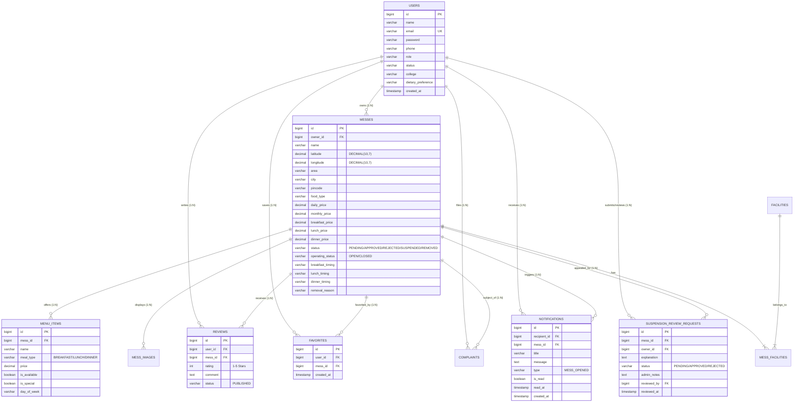

# MessMap — Complete Technical Viva & Architectural Reference Guide

> **Project Evaluation Reference Guide**  
> **Repository:** `SanvedSahu/MessMap`  
> **Working Branch:** `integration/backend-demo`  
> **Target Runtime:** Java 17 LTS / Node.js 18+  
> **Evaluation Mode:** Read-Only Audit & Verified viva Defense Reference  

---

## 1. System Architecture Overview

MessMap is a multi-role, location-aware campus dining and mess discovery platform built for college students, mess owners, and platform administrators. The system resolves the core problem of campus food discovery by providing real-time geolocation filtering, verified mess operating hours, daily menu item listings, student reviews, and direct notifications.

```
+-----------------------------------------------------------------------------------+
|                                  CLIENT LAYER                                     |
|  +-----------------------------------------------------------------------------+  |
|  |           React 18.3 + TypeScript 5.7 SPA (Vite 6.0 Build System)           |  |
|  |  - React-Leaflet 4.2 / Leaflet 1.9 (OSM Map Canvas & Pin Manipulation)      |  |
|  |  - HTML5 Geolocation API (Device GPS Acquisition)                           |  |
|  |  - Context API State: AuthContext, FavoritesContext, MessDataContext        |  |
|  |  - Role-Based Dynamic Layouts: Student, Mess Owner, Platform Administrator  |  |
|  +-----------------------------------------------------------------------------+  |
+-----------------------------------------|-----------------------------------------+
                                          | HTTPS / REST JSON (JWT Bearer Token)
                                          v
+-----------------------------------------------------------------------------------+
|                             BACKEND APPLICATION LAYER                             |
|  +-----------------------------------------------------------------------------+  |
|  |                  Spring Boot 3.3.4 (Java 17 LTS Runtime)                    |  |
|  |                                                                             |  |
|  |  [Security & Web Filters]                                                   |  |
|  |   - SecurityConfig: Stateless Session, CORS Source, CSRF Disabled           |  |
|  |   - JwtAuthenticationFilter -> JwtTokenProvider (HMAC-SHA256, 24-hr Expiry)|  |
|  |   - CustomUserDetailsService -> UserPrincipal (ROLE_STUDENT, OWNER, ADMIN)  |  |
|  |   - RestAccessDeniedHandler (403) & JwtAuthenticationEntryPoint (401)       |  |
|  |                                                                             |  |
|  |  [REST Controllers - 14 Controller Classes]                                 |  |
|  |   - MessController, OwnerMessController, AdminMessController                |  |
|  |   - AuthController, StudentAuthController, OwnerProfileController           |  |
|  |   - StudentProfileController, OwnerMenuController, ReviewController         |  |
|  |   - StudentFavoriteController, StudentNotificationController, AdminUser     |  |
|  |   - AdminMetricsController, HealthController                                |  |
|  |                                                                             |  |
|  |  [Business Service Layer]                                                   |  |
|  |   - MessDiscoveryService: Haversine distance, radius filtering, sort        |  |
|  |   - OwnerMessService: Listing creation, profile sync, open state gate       |  |
|  |   - AdminMessVerificationService: Verification, approval, suspension, removal|
|  |   - NotificationService: In-app alerts with 1-hour deduplication window     |  |
|  |   - ReviewService & OwnerMenuService: Ratings math & daily menu management  |  |
|  |                                                                             |  |
|  |  [Data Access Layer - Spring Data JPA & Hibernate 6.5]                     |  |
|  |   - 10 JPA Repositories (MessRepository, UserRepository, etc.)              |  |
|  |   - Dynamic Queries: MessSpecification (CriteriaBuilder multi-filtering)    |  |
|  +-----------------------------------------------------------------------------+  |
+-----------------------------------------|-----------------------------------------+
                                          | JDBC (HikariCP Connection Pool)
                                          v
+-----------------------------------------------------------------------------------+
|                              PERSISTENCE LAYER                                    |
|  +-----------------------------------------------------------------------------+  |
|  |  MySQL 8.0 Engine (InnoDB) / H2 2.2 In-Memory (Test/CI MySQL Mode)          |  |
|  |  - Flyway 10 Database Migrations (V1__initial_schema.sql to V8__notif)      |  |
|  |  - Relational Schema: 10 Normalized Tables with Foreign Key Constraints     |  |
|  |  - Spatial storage: DECIMAL(10, 7) Latitude and Longitude                   |  |
|  +-----------------------------------------------------------------------------+  |
+-----------------------------------------------------------------------------------+
```

---

## 2. Layered Architecture & Design Patterns

The backend follows the strict **Controller-Service-Repository-DTO-Entity** architecture, ensuring clean separation of concerns and testability:

### A. DTOs vs. Entities Separation
- **Entities** (`com.messmap.modules.*.entity.*`): Direct Hibernate mappings to MySQL tables (`@Entity`, `@Table`, `@Id`, `@ManyToOne`, `@OneToMany`). Entities contain persistence concerns, foreign keys, and audit timestamps.
- **DTOs** (`com.messmap.modules.*.dto.*`): Data Transfer Objects tailored for network serialization. They prevent exposing internal database identifiers, password hashes (`$2a$10$...`), or triggering unexpected lazy-loading outside active Hibernate sessions.
- **Why it matters in viva:** When asked why entities aren't returned directly from `@RestController`, the answer is:
  1. **Security:** Protects sensitive fields (e.g., user passwords).
  2. **Decoupling:** Database schema changes do not break mobile/frontend contracts.
  3. **Performance:** Eliminates Hibernate `LazyInitializationException` and circular reference serialization loops.

### B. Controller-Service-Repository Flow
1. **Controller Layer (`@RestController`)**: Handles HTTP protocol concerns (request mapping, path variables, query parameters, `@Valid` payload validation, HTTP status codes, and `ApiResponse<T>` envelope wrapping).
2. **Service Layer (`@Service`)**: Encapsulates transactional business logic (`@Transactional`), security validation, access control authorization checks, math calculations (Haversine formula), and domain event orchestration.
3. **Repository Layer (`@Repository`)**: Spring Data JPA interfaces extending `JpaRepository<T, ID>` and `JpaSpecificationExecutor<T>`. Manages database communication, custom JPQL queries, and database projection.

---

## 3. Database Schema & Relational Model

The database is versioned and migrated using **Flyway 10** (`V1` through `V8` in `backend/src/main/resources/db/migration/`).

### Entity Relationship Diagram (ERD)



### Table Definitions & Column Constraints

1. **`users`** (`V1`, `V3`):
   - `id`: `BIGINT AUTO_INCREMENT PRIMARY KEY`
   - `email`: `VARCHAR(150) NOT NULL UNIQUE` (B-Tree indexed: `idx_users_email`)
   - `password`: `VARCHAR(255) NOT NULL` (Stores BCrypt hash `$2a$10$...`)
   - `role`: `VARCHAR(30) NOT NULL` (`ROLE_STUDENT`, `ROLE_MESS_OWNER`, `ROLE_ADMIN`)
   - `status`: `VARCHAR(30) NOT NULL DEFAULT 'ACTIVE'` (`ACTIVE`, `SUSPENDED`, `DEACTIVATED`)
   - `dietary_preference`: `VARCHAR(30) DEFAULT 'VEG'` (`VEG`, `NON_VEG`, `BOTH`)

2. **`messes`** (`V1`, `V4`, `V5`, `V7`):
   - `id`: `BIGINT AUTO_INCREMENT PRIMARY KEY`
   - `owner_id`: `BIGINT NOT NULL` (FK -> `users.id`)
   - `name`: `VARCHAR(150) NOT NULL`
   - `latitude`: `DECIMAL(10, 7) NULL` (Stores geographic latitude up to 7 decimal places, precision ~1.1 cm)
   - `longitude`: `DECIMAL(10, 7) NULL` (Stores geographic longitude)
   - `area`, `city`, `pincode`: Locality descriptors (Indexed: `idx_messes_city`, `idx_messes_area`)
   - `status`: `VARCHAR(30) NOT NULL DEFAULT 'PENDING'` (`PENDING`, `APPROVED`, `REJECTED`, `SUSPENDED`, `REMOVED`)
   - `operating_status`: `VARCHAR(30) NOT NULL DEFAULT 'OPEN'` (`OPEN`, `CLOSED`)
   - Pricing: `daily_price`, `monthly_price`, `breakfast_price`, `lunch_price`, `dinner_price` (`DECIMAL(8, 2)`)
   - Timings: `breakfast_timing`, `lunch_timing`, `dinner_timing` (`VARCHAR(50)`)
   - `removal_reason`: `VARCHAR(500) NULL` (Mandatory audit log when admin removes listing)

3. **`menu_items`** (`V1`, `V5`):
   - `id`: `BIGINT AUTO_INCREMENT PRIMARY KEY`
   - `mess_id`: `BIGINT NOT NULL` (FK -> `messes.id ON DELETE CASCADE`)
   - `meal_type`: `VARCHAR(30) NOT NULL` (`BREAKFAST`, `LUNCH`, `DINNER`)
   - `price`: `DECIMAL(8, 2)`
   - `is_available`: `BOOLEAN NOT NULL DEFAULT TRUE`
   - `is_special`: `BOOLEAN NOT NULL DEFAULT FALSE`
   - `day_of_week`: `VARCHAR(20)` (`MONDAY`..`SUNDAY`, `DAILY`)

4. **`reviews`** (`V1`):
   - `id`: `BIGINT AUTO_INCREMENT PRIMARY KEY`
   - `user_id`: `BIGINT NOT NULL` (FK -> `users.id ON DELETE CASCADE`)
   - `mess_id`: `BIGINT NOT NULL` (FK -> `messes.id ON DELETE CASCADE`)
   - `rating`: `INT NOT NULL` (Validated 1 to 5)
   - `status`: `VARCHAR(30) NOT NULL DEFAULT 'PUBLISHED'`

5. **`favorites`** (`V1`):
   - `id`: `BIGINT AUTO_INCREMENT PRIMARY KEY`
   - `user_id`: `BIGINT NOT NULL` (FK -> `users.id ON DELETE CASCADE`)
   - `mess_id`: `BIGINT NOT NULL` (FK -> `messes.id ON DELETE CASCADE`)
   - **Composite Unique Constraint**: `uk_favorites_user_mess (user_id, mess_id)` prevents duplicate bookmarks.

6. **`notifications`** (`V8`):
   - `id`: `BIGINT AUTO_INCREMENT PRIMARY KEY`
   - `recipient_id`: `BIGINT NOT NULL` (FK -> `users.id ON DELETE CASCADE`)
   - `mess_id`: `BIGINT NOT NULL` (FK -> `messes.id ON DELETE CASCADE`)
   - `type`: `VARCHAR(50) NOT NULL DEFAULT 'MESS_OPENED'`
   - `is_read`: `BOOLEAN NOT NULL DEFAULT FALSE`
   - Composite index `idx_notifications_recipient_read (recipient_id, is_read)` optimizes unread count query.

---

## 4. End-to-End Data Flow

### Flow: Owner Map Pin -> Admin Moderation -> Student Nearby Discovery

```
[MESS OWNER]
   |
   | 1. Drops pin on Leaflet Map at (18.5236, 73.8418) or clicks "Use Device Location"
   | 2. Browser queries OSM Nominatim reverse geocode -> Auto-populates Area ("Shivajinagar") and PIN ("411004")
   | 3. Submits form -> POST /api/v1/auth/register/owner or POST /api/v1/owner/mess/profile
   v
[BACKEND CONTROLLER & SERVICE]
   |
   | 4. OwnerMessController validates coordinates: -90 <= lat <= 90, -180 <= lng <= 180
   | 5. OwnerMessService sets mess.status = PENDING, mess.operatingStatus = OPEN
   | 6. Persists to MySQL `messes` table
   v
[ADMINISTRATION & VERIFICATION GATEWAY]
   |
   | 7. Admin logs into /admin/dashboard -> GET /api/v1/admin/messes/pending
   | 8. Admin reviews details and clicks "Approve Mess" -> PUT /api/v1/admin/messes/{id}/approve
   | 9. AdminMessVerificationService transitions status PENDING -> APPROVED
   | 10. Audit log recorded in console: AUDIT: Admin [admin@messmap.com] approved mess [FC Road Mess] (ID: 42)
   v
[STUDENT NEARBY DISCOVERY]
   |
   | 11. Student opens /find-mess -> Browser GPS resolves student position: (18.5298, 73.8565)
   | 12. Student selects Radius: 3.0 km -> GET /api/messes/nearby?latitude=18.5298&longitude=73.8565&radiusKm=3.0
   | 13. MessDiscoveryService executes MessSpecification (WHERE status = 'APPROVED')
   | 14. Computes Haversine distance in Java for each mess: dist = 1.70 km
   | 15. Filters: 1.70 <= 3.0 km (Kept) -> Sorts ascending: [1.70 km, 2.45 km, ...]
   | 16. Returns ApiResponse<List<MessSummaryResponse>> with distanceKm = 1.7
   v
[STUDENT FRONTEND UI]
   |
   | 17. Finds mess card rendered with badge: "1.7 km away"
   | 18. Leaflet Map renders custom green SVG pin with popup and directions link
```

---

## 5. Security & Authentication Architecture

1. **Stateless JWT Flow**:
   - Client sends credentials (`email`, `password`) to `/api/auth/login`.
   - `AuthService` verifies credentials using Spring Security `AuthenticationManager`.
   - `JwtTokenProvider` signs a JWT containing `userId`, `email`, `name`, and `role` claims using an HMAC-SHA256 key (`messmap.jwt.secret`).
   - Token validity is 24 hours (`86,400,000 ms`).
   - Client stores token in `localStorage` and transmits it in the HTTP Header: `Authorization: Bearer <token>`.

2. **Role-Based Access Control (RBAC)**:
   - Configured in `SecurityConfig.java`:
     - Public: `/api/health`, `/api/auth/**`, `GET /api/messes/**`
     - Student: `/api/student/**` requires `ROLE_STUDENT` or `ROLE_ADMIN`
     - Owner: `/api/owner/**` requires `ROLE_MESS_OWNER` or `ROLE_ADMIN`
     - Admin: `/api/admin/**` strictly requires `ROLE_ADMIN`
   - Method-level `@PreAuthorize("hasRole('MESS_OWNER') or hasRole('ADMIN')")` enforces fine-grained authorization.

3. **Ownership Verification**:
   - `OwnerMessService.resolveTargetMess(ownerId, messId, isAdmin, action)` prevents Insecure Direct Object References (IDOR). If an authenticated owner passes `messId=99` belonging to another owner, it throws HTTP 403 `AccessDeniedException`.

4. **BCrypt Password Hashing**:
   - All passwords hashed using `BCryptPasswordEncoder` with standard cost factor 10. Raw passwords are never logged, stored, or exposed in DTO responses.

---

## 6. Testing & Reliability Architecture

- **Test Suite Status**: **344 Automated Tests Passing** (`Tests run: 344, Failures: 0, Errors: 0, Skipped: 0`).
- **Target JDK Runtime**: **Java 17 LTS**.
  > [!IMPORTANT]
  > Under Java 25, Mockito's inlined mock maker encounters ByteBuddy agent restrictions (`JEP 451: Prepare to Disallow the Dynamic Loading of Agents`). Running with `JAVA_HOME` pointing to Java 17 LTS or passing `-XX:+EnableDynamicAgentLoading` ensures 100% test execution success.

- **Test Breakdown**:
  1. **Controller Tests (`@WebMvcTest` / MockMvc)**: Test HTTP status codes, JSON serialization, path mapping, and security filters with mocked service layers.
  2. **Repository Tests (`@DataJpaTest`)**: Run in-memory H2 database in MySQL compatibility mode with Flyway migrations applied automatically to verify SQL constraints, indexes, and JPA queries.
  3. **Service Unit Tests (`Mockito`)**: Test business rules, Haversine formula bounds, status transition state machines, and notification deduplication.
  4. **Full E2E Integration Tests (`@SpringBootTest`)**: Complete multi-step flows (`StudentOwnerAdminE2EFlowIntegrationTest`).
